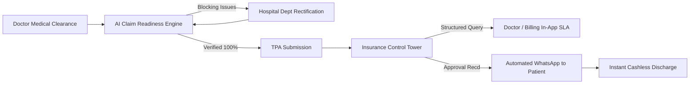

<div align="center">

# ✦ Vigneshwar Kannan
### Business Analyst & Certified Product Owner (PSPO I™)

[](https://vigneshwark27.github.io/Vigneshwar-Kannan-Portfolio-Website-/)
[](https://www.linkedin.com/in/vigneshwarkannan)
[](assets/images/Professional%20Scrum%20Product%20Owner%20I.pdf)
[](https://www.linkedin.com/in/vigneshwarkannan)

<p align="center">
  <b>Transforming complex operational bottlenecks and enterprise workflows into scalable, AI-accelerated B2B SaaS, HealthTech, and Consumer products.</b>
</p>

[Explore Projects](#-featured-product-case-studies) • [Product Competencies](#-product-management-competencies) • [Certifications](#-certifications--credentials) • [Portfolio Architecture](#-technical-architecture)

---

</div>

## 📌 Executive Summary

I am a **Business Analyst & Certified Product Owner (PSPO I™)** currently working at **Ivy Mobility** (Sep 2026 – Present). My background blends enterprise revenue-cycle operations, Agile/Scrum backlog ownership, AI feature prototyping, and user-centric systems design.

- 🎯 **Domain Focus:** Enterprise B2B SaaS, HealthTech Operations, AI-Powered Workflows, Growth & Retention Strategy.
- 📐 **Product Mindset:** Relentlessly data-informed, guardrail-oriented, and focused on reducing operational cycle times while safeguarding compliance and margins.
- 🛠️ **Execution Style:** Hands-on from discovery and PRD authoring to user stories (Gherkin AC), interactive flow diagrams, prototyping, and cross-functional engineering alignment.

---

## 🚀 Featured Product Case Studies

| # | Project | Domain | Key Deliverable | North Star Metric |
|---|---------|--------|-----------------|-------------------|
| **01** | [CarePulse](#1-carepulse--cashless-hospital-discharge-automation) | HealthTech SaaS | PRD + 5 Flow Diagrams + Live HMS App | **60% TAT Reduction** |
| **02** | [Chargebee AI](#2-chargebee--ai-contract-to-subscription-feature) | FinTech / B2B SaaS | PRD + Backlog + CodeSandbox Prototype | **70% Setup Time Saved** |
| **03** | [VisionFlow](#3-visionflow--ai-goal-anchored-productivity-app) | Consumer AI | Gemini 1.5 Pro Applet + Teardown Deck | **Zero-Guilt Retention** |
| **04** | [Patent AI](#4-patent-ai--patent-claim-analytics-workspace) | LegalTech AI | Dual-Pane UX + Claude Prototype + PRD | **8x Review Velocity** |
| **05** | [Gen-Z Clothing Brand](#5-gen-z-clothing-brand--product-design-system) | Mobile E-Commerce | End-to-End Design System + Figma Proto | **0-Friction Checkout** |
| **06** | [Ola Tier 2/3 Teardown](#6-ola-app--tier-23-market-optimization-teardown) | Mobility & Logistics | UX Audit + Product Teardown Deck | **25% Drop-off Reduction** |
| **07** | [AmbitionBox Growth](#7-ambitionbox--25-retention-growth-strategy) | Growth & Community | 6-Month Retention Roadmap Deck | **+25% D30 Retention** |

---

### 1. CarePulse — Cashless Hospital Discharge Automation
> **Enterprise HealthTech SaaS • Operations Control Tower & Automation Suite**

* **The Problem:** Indian private hospitals suffer ₹15–30 lakh in delayed revenue monthly due to cashless discharge lag. Post medical clearance, patients wait 4–8 hours due to missing insurance paperwork, opaque TPA queries, and billing bottlenecks.
* **The Solution:** An end-to-end hospital operations suite combining an **AI Claim Readiness Checklist**, a real-time **Insurance Control Tower**, and a **Patient WhatsApp Transparency Layer**.
* **Key Artifacts:**
  * 📋 [Full PRD on Notion](https://www.notion.so/Cashless-Hospital-Discharge-Orchestration-3bd22c713ac980faaf21e6c2f9790d25)
  * ⚡ [Interactive 5-Diagram Flow Suite](carepulse-flows/index.html) (Future State, Current State Swimlane, Claim Readiness, Control Tower, Patient Comm)
  * 🏥 [CareFlow HMS Live Simulation App](carepulse-flows/preview_all_features.html)
* **Impact & Guardrails:**
  * **60% reduction** in median discharge delay post medical clearance (~6h → ~2.4h).
  * **100% pre-submission audit accuracy** via blocking vs advisory validation rules.
  * **40% drop** in billing desk patient grievances.



---

### 2. Chargebee — AI Contract-to-Subscription Feature
> **Enterprise Billing B2B SaaS • Ingestion Pipeline & Human Confirmation UX**

* **The Problem:** Billing managers spend 30–45 minutes per contract manually copying terms from signed enterprise sales PDFs into Chargebee, leading to ~12% billing discrepancy rates and revenue recognition delays.
* **The Solution:** AI-driven contract parsing engine that extracts billing cycles, custom pricing tiers, add-ons, and payment milestones, presenting a split-screen verification interface before generating a draft subscription.
* **Key Artifacts:**
  * 📋 [Full PRD & Backlog on Notion](https://www.notion.so/PRD-Chargebee-Contract-to-Subscription-using-AI-feature-31622c713ac980cc8b91d0c125bc9618)
  * ⚡ [Working Prototype on CodeSandbox](https://gx34dn.csb.app/)
  * 📐 [Interactive Process Flow Diagram](https://mockup-runway-03382669.figma.site/)
* **Product Safeguards & Metrics:**
  * **Zero Auto-Billing Risk:** AI-parsed outputs strictly land in "Draft" status — requiring human validation before ledger activation.
  * **Setup Velocity:** Reduced contract setup time from 45 mins to < 2 mins (95th percentile).
  * **Extraction Precision:** Target >92% accuracy across non-standard enterprise contracts.

---

### 3. VisionFlow — AI Goal-Anchored Productivity App
> **Consumer AI UX • Gemini 1.5 Pro Applet & Habit Economics**

* **The Problem:** 80%+ of productivity app users abandon to-do lists within 3 weeks because tasks feel detached from long-term life aspirations, and missing single-day streaks triggers guilt-induced churn.
* **The Solution:** Built on Google AI Studio using Gemini 1.5 Pro, VisionFlow enforces goal-anchored task hierarchy: every daily task must link to a high-level Vision Card. Features chromatic photo fill, AI peak focus scheduling, and tokenized rest days.
* **Key Artifacts:**
  * 🤖 [Live Gemini AI Studio Applet](https://ai.studio/apps/7a5233f8-33cf-4464-8e07-53175fec4a41?fullscreenApplet=true)
  * 📄 [Design Teardown & Strategy Deck (PDF)](https://drive.google.com/file/d/1XpayTK5nTvvwYyikXCO40JEn0-5b2IUB/view?usp=sharing)
* **Behavioral Innovations:**
  * **Chromatic Visual Progression:** Vision card images start monochrome and burst into full color as linked tasks complete.
  * **Guilt-Free Rest Token Economy:** 4 monthly buffer tokens freeze streaks automatically without penalty.
  * **Gemini Focus Window Detection:** Proactively schedules deep-work milestones during peak cognitive energy slots.

---

### 4. Patent AI — Patent Claim Analytics & Litigation Workspace
> **LegalTech IP Intelligence • Dual-Pane Conversational Interface**

* **The Problem:** IP attorneys and patent analysts spend 2+ hours per claim chart cross-referencing legal claim language against dense technical specifications. Generic LLMs hallucinate citations, causing catastrophic litigation risks.
* **The Solution:** A specialized dual-pane analysis environment featuring an automated claim critique stream paired with a persistent claim element tracking matrix.
* **Key Artifacts:**
  * 🤖 [Functional Claude AI Workspace Prototype](https://claude.ai/public/artifacts/5c7f110e-e12f-41ca-b48f-1899cef5a55c)
  * 📐 [Interactive Architecture & Flow Diagram](https://stomp-hatch-92389255.figma.site/)
  * 📋 [Full PRD on Notion](https://www.notion.so/Lumenci-Assignment-3a622c71-3ac9-80dab62ee34f268402a2)
* **Guardrails & Efficiency:**
  * **Non-Hallucination Hard Stop:** AI strictly halts and flags "Pending Evidence" if uploaded technical specs lack direct factual proof.
  * **Review Speedup:** Cut analysis time from ~120 minutes to <15 minutes per 7-element chart (8x velocity gain).
  * **85%+ Acceptance Rate:** Over 85% of AI-mapped claim elements accepted by human analysts without modification.

---

### 5. Gen-Z Clothing Brand — Product Design System
> **Mobile E-Commerce UX • Visual-First Shopping Experience**

* **The Problem:** Traditional mobile e-commerce menus are text-heavy and checkout funnels require 5+ pages, causing over 70% cart abandonment among Gen-Z shoppers with short attention spans.
* **The Solution:** A visual-first mobile app experience modeled after content discovery feeds (Instagram Reels / TikTok), featuring full-bleed trend feeds, swipe-up cart gestures, and a 2-tap UPI checkout.
* **Key Artifacts:**
  * 🎨 [Interactive Figma Prototype](https://www.figma.com/proto/9QxhmIwIwpRSoKGVRpOVF9/vicky?node-id=24-3&starting-point-node-id=24%3A3&t=gP71SKR7SD5bTenF-1)
* **Results:**
  * Complete end-to-end journey from discovery to confirmation designed with micro-interactions.
  * Checkout journey compressed from 5 screens to under 30 seconds.

---

### 6. Ola App — Tier 2/3 Market Optimization Teardown
> **Ride-Hailing Mobility UX • Growth & Regional Usability**

* **The Problem:** Ride-hailing penetration stalls in India's Tier 2 and Tier 3 cities due to address ambiguity, overwhelming vehicle choice screens, and 2G/3G network drops during booking requests.
* **The Solution:** Proposed landmark-assisted pickup tags, progressive vehicle disclosure (prioritizing Autos & Mini), offline-tolerant booking queues, and one-tap regional language detection.
* **Key Artifacts:**
  * 📄 [Comprehensive UX Teardown Presentation (PDF)](https://drive.google.com/file/d/1UO1ij-67LFEumMwNrRplr2s9BjuseMkR/view?usp=sharing)
* **Projected Impact:**
  * 25% projected reduction in booking drop-offs across suburban/non-metro locations.
  * ~18% decrease in driver cancellations via landmark-linked pickup coordinates.

---

### 7. AmbitionBox — 25% Retention Growth Strategy
> **Career Intelligence Platform • Gamified Content Economy & Alert Loops**

* **The Problem:** Over 60% of AmbitionBox visitors bounce after checking a single salary or interview review, failing to return once their immediate job interview concludes (D30 retention < 18%).
* **The Solution:** A 6-month growth roadmap introducing AI Salary Benchmark Alerts, Weekly Interview Intelligence Digests, and a "Give 1 to Read 10" gamified review economy.
* **Key Artifacts:**
  * 📄 [6-Month Product Strategy & Roadmap Deck (PDF)](https://drive.google.com/file/d/1gZb3Y2EqE2lltr2TbtfzZG0XfyM329Aa/view?usp=sharing)
* **Projected Impact:**
  * D30 user retention lift from 18% to 22.5%+ (+25% relative growth).
  * 3x expansion in authentic company review submissions per month.

---

## 🛠️ Product Management Competencies

```
┌───────────────────────────┬───────────────────────────┬───────────────────────────┐
│  Discovery & Strategy     │  Technical & AI PM        │  Agile & Execution        │
├───────────────────────────┼───────────────────────────┼───────────────────────────┤
│ • Problem Framing & Opps  │ • LLM Prompt Architecture │ • PSPO I™ Scrum Framework │
│ • Competitive Teardowns   │ • Guardrails & Safety     │ • User Stories & Gherkin  │
│ • User Journey Mapping    │ • API & Webhook Workflows │ • Sprint Backlog Grooming │
│ • North Star & KPI Trees  │ • System State Machines   │ • Jira & Kanban Velocity  │
│ • Retention Loops         │ • Rapid Prototyping       │ • Cross-Functional Ops    │
└───────────────────────────┴───────────────────────────┴───────────────────────────┘
```

### Tools & Technologies
- **Product & Design:** Figma, FigJam, Miro, Notion, Balsamiq
- **Analytics & Tracking:** Google Analytics (GA4), Mixpanel, PostHog, SQL Basics
- **Development & AI:** Gemini 1.5 Pro API, Claude Artifacts, CodeSandbox, HTML5/CSS3/JavaScript, Git/GitHub
- **Collaboration & Agile:** Jira, Confluence, Trello, Slack

---

## 🎓 Certifications & Credentials

| Credential | Issuing Body | Date | Verification |
|------------|--------------|------|--------------|
| **Professional Scrum Product Owner™ I (PSPO I)** | Scrum.org | Jul 2026 | [View Certificate PDF](assets/images/Professional%20Scrum%20Product%20Owner%20I.pdf) |
| **Strategy & Consulting Virtual Experience** | Boston Consulting Group (BCG) | 2024 | [View Certificate PDF](assets/images/BCG%20certifiation.pdf) |
| **Jira Fundamentals Certification** | Atlassian | 2024 | [View Certificate PDF](assets/images/Jira%20Fundamentals%20_%20Atlassian.pdf) |
| **Google Analytics (GA4) for Beginners** | Google | 2024 | [View Certificate PDF](assets/images/google%20analytics%20for%20beginners.pdf) |
| **Product Discovery Certification** | Pendo | 2024 | [View Certificate PNG](assets/images/product-discovery-certification.png) |
| **Product Management Job Simulation** | Electronic Arts × Forage | 2024 | [View Certificate PDF](assets/images/5genWYpfo5b57G7yv_Electronic%20Arts_X3hmrNXi4MbmM5nJK_1720582624206_completion_certificate.pdf) |
| **Agile Requirements Foundations** | LinkedIn Learning | 2024 | [View Certificate PDF](assets/images/CertificateOfCompletion_Agile%20Requirements%20Foundations%20(1)%20(1).pdf) |
| **Project Management Foundations: Requirements** | LinkedIn Learning | 2024 | [View Certificate PDF](assets/images/CertificateOfCompletion_Project%20Management%20Foundations%20Requirements%20(1)%20(1).pdf) |
| **Fundamentals of Project Management** | Philanthropy University | 2024 | [View Certificate PDF](assets/images/PhilanthropyUniversity_FundamentalsofProjectManagement.pdf) |

---

## 🏗️ Technical Architecture of This Repository

This repository hosts Vigneshwar's live portfolio built with high performance and zero external bundle lag:

```
├── index.html                  # Light minimalist portfolio frontend (semantic HTML5)
├── style.css                   # Custom CSS design system (tokens, cards, responsive grid)
├── script.js                   # Zero-lag popup engine, state drawers & embed fallback router
├── carepulse-flows/            # Locally hosted CarePulse process architecture suite
│   ├── index.html              # Multi-diagram interactive tab switcher
│   ├── future_state_orchestration.html
│   ├── current_state_swimlane.html
│   ├── claim_readiness.html
│   ├── claim_control_tower.html
│   ├── patient_communication.html
│   └── preview_all_features.html  # Live Hospital Management System simulation
└── assets/
    └── images/                 # Optimized covers, SVG icons, and verified certificates
```

### Engineering Highlights:
* **Zero-Lag Architecture:** Vanilla HTML/CSS/JS without heavyweight UI frameworks (loads in < 400ms).
* **Smart Embed Fallback Router:** Automatically identifies external security headers (`X-Frame-Options: SAMEORIGIN` / CSP `frame-ancestors`) and renders structured launchpad cards with architectural overviews instead of blank iframes.
* **Embedded Local Flows:** Hosts interactive process diagrams directly within the repository origin to bypass third-party rate limits and iframe restrictions.

---

## 📬 Contact & Connect

- **Portfolio:** [https://vigneshwark27.github.io/Vigneshwar-Kannan-Portfolio-Website-/](https://vigneshwark27.github.io/Vigneshwar-Kannan-Portfolio-Website-/)
- **LinkedIn:** [linkedin.com/in/vigneshwarkannan](https://www.linkedin.com/in/vigneshwarkannan)
- **Resume:** [View on Google Drive](https://drive.google.com/file/d/1pjweNhEWDgFfcVVKSY8xt2iXjQ0stlUL/view?usp=sharing)

---
<div align="center">
  <sub>© 2026 Vigneshwar Kannan • Designed with intention & data.</sub>
</div>
